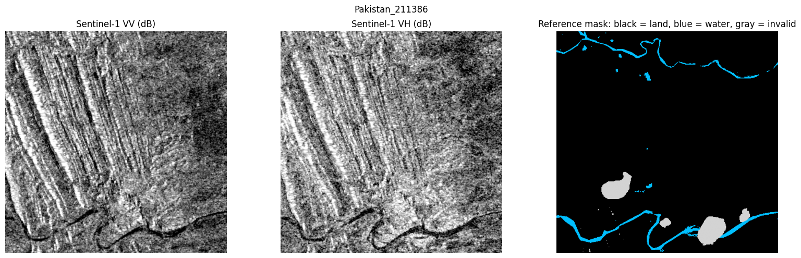
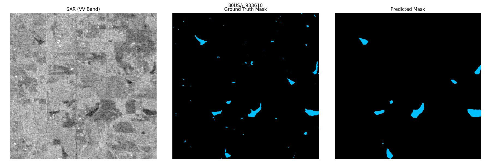
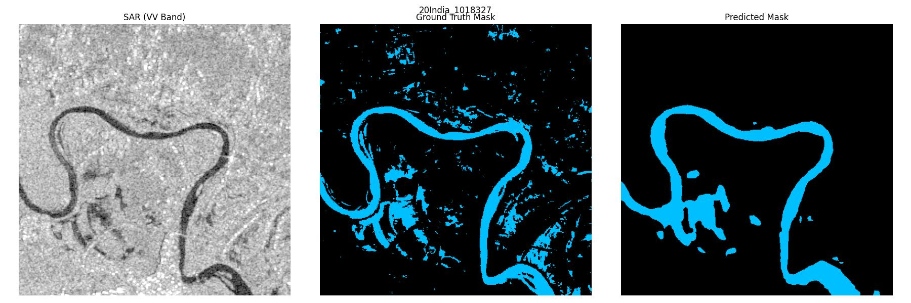
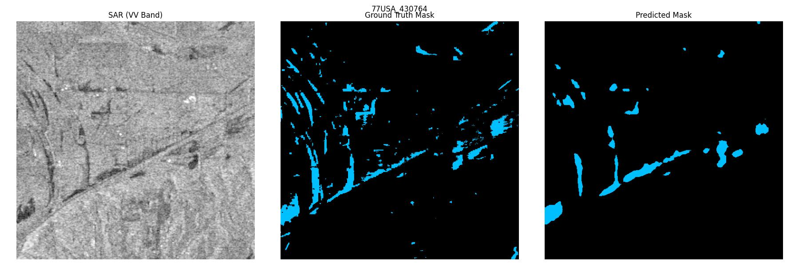
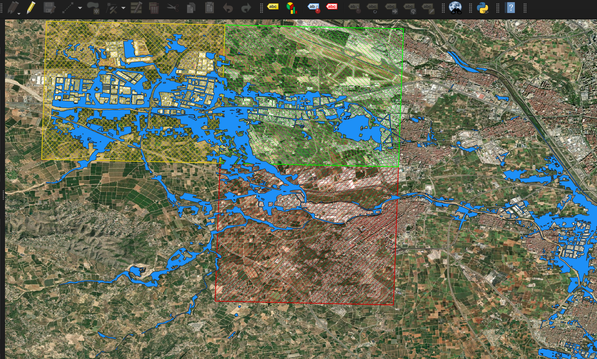

# Flood Detection using Fine Tuned SegFormer

(Contributors: Manasvin)

## Motivation

This project was an exploration into how SOTA vision/segmentation models can be extended to flood detection, particularly on SAR radar input. Most SOTA vision models are built on RGB input, but flood detection using RGB is constrained by data availability. Cloud cover, weather/lighting constraints etc make RGB less riable for real time flood mapping. This project was an excersise to compare the performance of SOTA models on flood detection by fine tuning them. Finally I wanted to see how these models would perform on a complete new image from a flood (Valencia Oct 24) that took place after the dataset was prepared.

## Data / Models / Methods

For these experiments, I went with the SegFormer B2 model for the backbone. SegFormer doesnt have positional encodings, so it should be a better fit than other Vision Transformers, as the remote sensing SAR input/flood location in not constrained spatially in anyway. It should also be able to handle speckle noise in the SAR input.

This backbone is finetuned on Sen1Floods11 data, on the VV and VH bands (with a third channel of VV/VH). Theres some minor data pre-processing including bounding the decibel ranges to [-30,0] and normalizing the values to [0,1].
The Sen1Floods11 dataset consists of two types of data, (1) 446 SAR snapshots with handlabelled ground truth flood masks and (2) ~4k weakly labelled masks. For this experiement, I am only using the hand labelled subset.(Along with data augmentation) 
As shown below each datapoint contains a 512x512 input for (a) VV and (b) VH along with the corresponding truth mask (with flood/dry land and invalid regions).

As we can see, most of the pixels will usually be of land with only a part of the image corresponding to water/flood. In the entire training set, < 10% fo the valid pixels were water. (re: Data_Download.py)
So we handle this class imbalance, as training the model on regular cross entroy will not be sufficient to make the model prioritize flood pixels.
For this I tried a few different loss functions, (implemented in CustomLoss_FineTuning.ipynb)

#### Weighted Cross Entropy

Similar to the regular cross entropy functions, but an increased weightage is given to water pixels. (3x/5x etc).

$$\text{WCE} = -\left( \omega_{water} \cdot y \log(p) + \omega_{land} \cdot (1 - y) \log(1 - p) \right)$$

*Where $`y`$ is the ground truth and $`p`$ is the predicted label ($`0`$ or $`1`$), and $`\omega_water`$ and $`\omega_land`$ are the assigned class weight.*

#### FOCAL + DICE hybrid

This function uses a combination of focal and dice loss. 
FOCAL loss is still at the pixel level like Cross Entropy but it operates dynamically making the loss contribution of pixel that are "easy"(ex. very clearly land) lower. So the model tuning is driven more by the edge case pixels.

$$\text{FL}(p_t) = -\alpha_t (1 - p_t)^\gamma \log(p_t)$$

*Where $`p_t`$ is the model's estimated probability for the water/flood class, $`\alpha_t`$ handles class imbalance, and $`\gamma`$ is the focusing parameter (typically set to $`2.0`$).*

Moving beyond the pixel level, these models have to be graded on how the predicted flood regions overlap with the true flood region structure. As such, our metric of interest if IoU, which basically measures the extent of overlap in the predicted and true flood regions. DICE loss is a differentiable proxy that can be used to optimize for IoU.

$$\text{Dice Loss} = 1 - \frac{2 \sum_{i=1}^{N} y_i p_i + \epsilon}{\sum_{i=1}^{N} y_i + \sum_{i=1}^{N} p_i + \epsilon}$$

*Where $`y_i`$ represents the ground truth mask, $`p_i`$ represents the predicted mask, and $`\epsilon`$ is a small smoothing constant to prevent division by zero.*

#### DoRA

Considering we are full fine tuning with < 300 training samples, there is a possibility of overfitting, so I also ran a few experiments, adding a DoRA component(which restricts weight updates).

## Results

The results below (on validation set) are the average of 10 runs of each model (note: the data augmentation process means the models arent trained on the exact same set)

| Loss  | Pixel Accuracy | Mean IoU | Water IoU |
| :-------- | :--- | :--- | :--- |
| Cross Entroy | 0.81 | 0.75 | 0.55 |
| Weighted Cross Entropy | 0.90 | 0.74 | 0.56 |
| FOCAL + DICE | 0.87 | 0.77 | 0.64 |
| FOCAL + DICE (DoRA, rank=16) | 0.81 | 0.73 | 0.54 |
| FOCAL + DICE (DoRA, rank=32) | 0.85 | 0.77 | 0.59 |

As expected, FOCAL+DICE helps optimize IoU, with the FOCAL+DICE full fine tunining model getting the best results at 64% water IoU.

Running this model on the held out test set, gave similar results with a pixel accuracy around 90% and water IoU around 65% (mean IoU around 80%).

Below are a few test set examples of how the model predicted (more output screenshots in the "Test_Results" folder)

## Valencia Floods Experiment

Just a random experiment to see if the models truly generalized. For the ground truth mask, I used the Copernicus Emergency Management Service public flood event map, rasterized on QGIS to get the  512x512 truth masks for three separate areas around valencia.

For the SAR input, for the relevant areas I got the vv and vh bands from Sentinel-1 appropriately and passed it to the model with the same preprocessing.
None of the models performed well on this test, with FOCAL+DICE model again the best, but water IoU was only about 15%, much less than the 65% reported on the test set.
